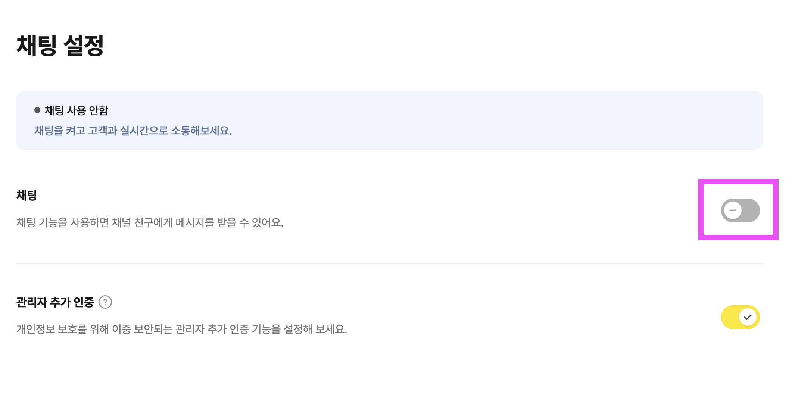
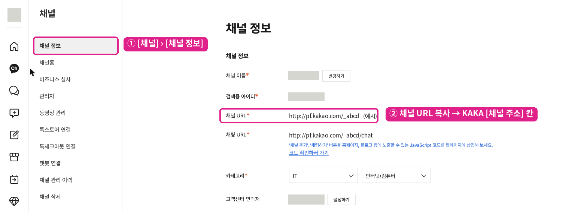

# 1단계 · 카카오톡 채널 준비

이미 채널이 있으면 **1-2 비즈니스 인증**과 **1-3 1:1 채팅 끄기**만 확인하고 [2단계](02-install-app.md)로 넘어가세요. 1-3은 가장 많이 놓치는 부분이에요.

## 1-1. 채널 개설

1. [카카오비즈니스](https://business.kakao.com)에 접속해 카카오 계정으로 로그인하세요.
2. **채널 만들기**를 누르고 채널 이름, 검색용 아이디, 프로필 이미지를 넣으세요.
3. 검색용 아이디는 손님이 검색으로 찾는 이름이에요. 나중에 바꾸기 번거로우니 신중히 정하세요.


비즈니스 인증이 끝나기 전에도 채널을 만들고 연결 테스트까지는 할 수 있어요. 다만 손님 화면에 "사업자 정보가 확인되지 않은 채널" 안내가 뜨니, **실제 운영은 비즈니스 인증을 마친 뒤** 시작하세요.


## 1-2. 비즈니스 인증 (필수)

사업자등록증으로 인증해요. 심사에 **1~2영업일**이 걸리니 **지금 먼저 신청해 두고** 나머지 단계를 진행하세요.

비즈니스 인증은 카카오 커넥터를 쓰는 데 꼭 필요해요. 4분이 지난 답장([6단계](06-late-reply.md))과 예약 알림톡([선택 B](10-booking-alimtalk.md))은 인증된 채널에서만 쓸 수 있어요.

## 1-3. 1:1 채팅 끄기와 24시간 운영 ⚠️

**카카오비즈니스 파트너센터**(옛 채널 관리자센터) → 왼쪽 **[채팅]** → [**채팅 설정**]에서 확인하세요.

![파트너센터 [채팅] › [채팅 설정] — '채팅' 스위치가 꺼진(회색) 상태면 돼요](../../../.gitbook/assets/kakao-connector/ch-02-chat-off.png)

* **'채팅' 스위치는 꺼 둡니다(회색).** 켜져 있으면 손님 화면에 "상담 연결" 버튼이 뜨고, 손님이 그걸 누르면 **챗봇이 불리지 않아 메시지가 하이퍼클래스로 들어오지 않아요.**
* 채팅 **운영시간이 정해져 있으면 24시간**으로 바꾸세요. 운영시간 밖에는 챗봇이 불리지 않아요.
* 이미 상담 모드로 이어진 대화가 있으면 **상담 종료**를 눌러 풀어 주세요.


**1:1 채팅(상담) 모드에 들어가 있는 손님의 메시지는 하이퍼클래스에 들어오지 않아요.** 챗봇이 아예 불리지 않기 때문이에요.

* 상담 모드로 들어가는 경우: '채팅'이 켜진 채널에서 손님이 **채팅방을 나갔다가 다시 들어오거나**, **"상담 연결" 버튼**을 누를 때예요.
* 손님 채팅방 위쪽에 "○○ 안에 응답 · 응답률"이 보이고 입력창에 **"상담 종료"** 버튼이 있으면 상담 모드예요.
* 손님 화면에 "진행중인 상담을 종료하고 챗봇 대화를 시작하시겠습니까?"가 뜨면, **[확인]을 누른 뒤 보낸 메시지부터** 들어와요.

'채팅' 스위치를 꺼 두면 이런 일이 생기지 않아요.


## 1-4. 채널 URL 확인

**파트너센터 → [채널] → [채널 정보**]에서 **채널 URL**을 복사해 두세요. 검색용 아이디(`mybrand`)와는 다른 값이에요.

| 항목 | 예시 | 어디에 쓰나요 |
| --- | --- | --- |
| 채널 URL | `https://pf.kakao.com/_abcdef` | 카톡채팅연결 1단계 **채널 주소** ([2단계](02-install-app.md)) |
| 채팅 URL | `https://pf.kakao.com/_abcdef/chat` | 알림톡 버튼, 홈페이지 버튼 ([선택 B](10-booking-alimtalk.md) · [선택 C](11-website-button.md)) |

채널 URL은 `pf.kakao.com/_`로 시작해요. `_` 없이 검색용 아이디를 넣으면 링크가 깨질 수 있어요.

다음: [2단계 · 앱 설치와 설정 화면 둘러보기](02-install-app.md)
