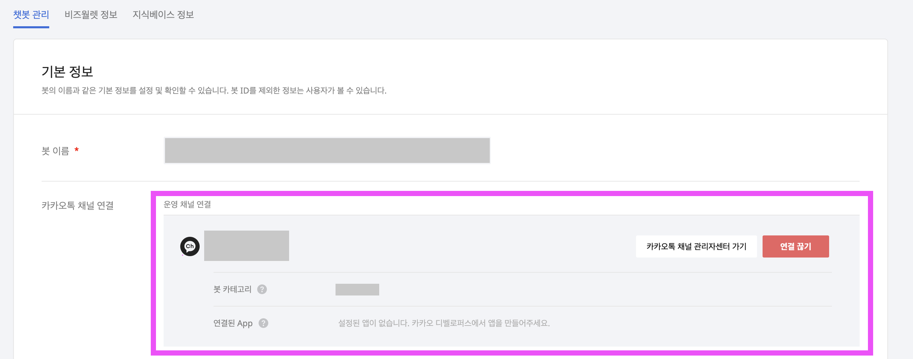
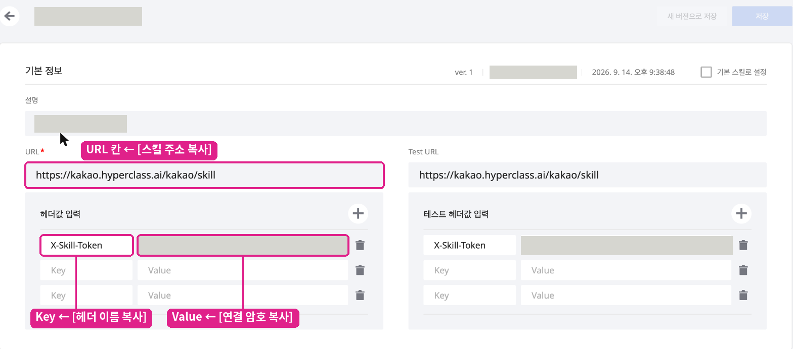
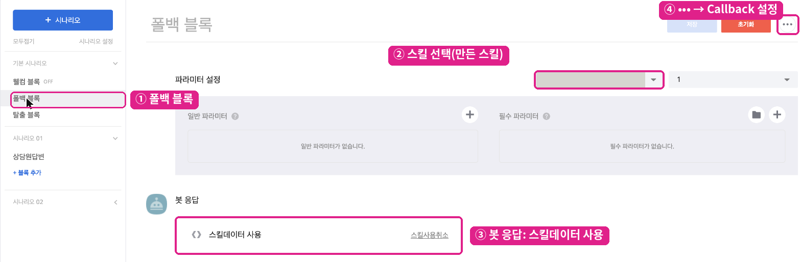
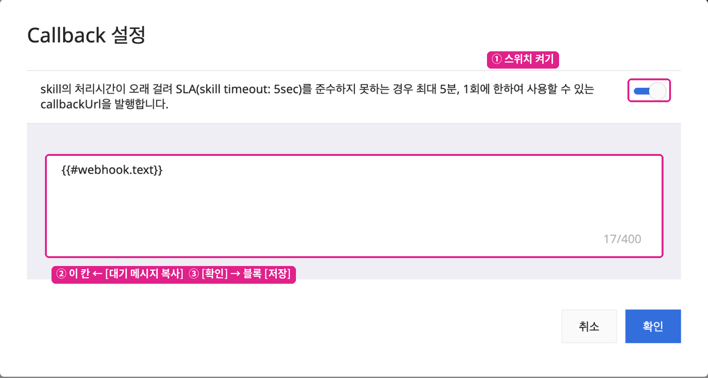

# 3단계 · 챗봇 연결(오픈빌더) ⭐ 핵심

여기서 만드는 것은 "**손님이 카카오톡에 보낸 말을 하이퍼클래스로 넘겨주는 통로**"예요. 챗봇이 답을 만드는 게 아니라 **배달만** 해요.


**먼저 카톡채팅연결 화면의 2단계(챗봇 연결)를 열어 두세요.** 복사할 값(스킬 주소, 헤더 이름, 연결 암호, 대기 메시지)이 모두 그 화면에 있어요. 아래 ①~④를 **순서대로** 하고, 마지막에 꼭 **배포**를 누르세요.


## ① 봇 만들고 채널 연결 ⚠️

1. [카카오 i 오픈빌더](https://i.kakao.com)에 접속해 카카오 계정으로 로그인하세요. 화면의 [**오픈빌더 열기 ↗**]로 가도 돼요.
2. **챗봇 관리자센터 → 내 챗봇**에서 [**+ 채널 챗봇 만들기**]를 누르고, **카카오톡 챗봇**을 골라 이름을 넣으세요.

![챗봇 관리자센터 — [+ 채널 챗봇 만들기]](../../../.gitbook/assets/kakao-connector/bot-01-create.png)

3. 만든 봇에 들어가 왼쪽 메뉴 **[설정] → [챗봇 관리]** 탭을 여세요.
4. **운영 채널 연결** 옆 [**운영 채널 선택하기**]에서 1단계에서 만든 **내 채널**을 고르세요. **개발 채널 연결**은 비워 둬요.
5. 오른쪽 위 [**저장**]을 누르세요. 왼쪽 위 **운영채널**에 내 채널 이름이 보이면 연결된 거예요.

6. 같은 화면 맨 아래 **봇 ID** 옆 복사 아이콘을 눌러 복사하고, 카톡채팅연결 2단계의 **봇 ID** 칸에 붙여넣은 뒤 [**저장**]하세요.

![[설정] › [챗봇 관리] — 운영 채널 선택과 봇 ID 복사](../../../.gitbook/assets/kakao-connector/bot-02-settings.png)


* 채널 연결을 빼먹으면 손님 메시지가 봇으로 오지 않아요.
* 채널 목록에 여러 채널이 보이면 이 봇을 쓸 채널 **하나만** 고르세요. 이미 다른 봇이 연결된 채널을 고르면 그 봇의 연결이 바뀌어요.
* **봇 하나는 매장(워크스페이스) 하나**에만 쓸 수 있어요. 다른 계정에 이미 연결된 봇 ID를 넣으면 "이미 다른 계정에 연결된 봇 ID예요"가 떠요. 이 매장용 봇을 새로 만드세요.


## ② 스킬 등록

스킬은 손님 메시지를 카카오 커넥터로 넘기는 **주소**예요.

1. 오픈빌더 왼쪽 메뉴 **[스킬] → [스킬 목록]** → 오른쪽 위 [**생성**]을 누르세요.
2. 이름은 아무거나 넣어도 돼요(예: `연결`). 설명도 자유예요.
3. **URL** 칸에 카톡채팅연결의 **[스킬 주소 복사]** 값을 붙여넣으세요.
4. **헤더값 입력**의 [**+**]를 누르고
   * **Key**: **[헤더 이름 복사]** 값 `X-Skill-Token`
   * **Value**: **[연결 암호 복사]** 값(화면에는 ●●●●로 가려져 보여요)
5. 오른쪽 위 [**저장**]을 누르세요. 위쪽에 `ver. 1`과 저장 시각이 뜨면 저장된 거예요.


**헤더 값 앞뒤에 공백이나 줄바꿈이 따라오지 않았는지 확인하세요.** 붙여넣을 때 보이지 않는 문자가 섞이면 카카오는 오류 표시 없이 **조용히 실패**해요(스킬 오류 내역에도 남지 않아요). 연결이 안 되면 헤더 줄을 휴지통 아이콘으로 지우고 Key·Value를 다시 넣은 뒤 저장 → 배포하세요.

* **기본 스킬로 설정** 체크는 필요 없어요. **Test URL** 칸도 비워 둬요.
* 스킬을 [**새 버전으로 저장**]했다면 아래 ③ 폴백 블록에서도 그 버전을 다시 골라 주세요.
* 연결 암호는 재발급되지 않아요. 다시 필요하면 카톡채팅연결 2단계의 [**연결 암호 복사**]로 다시 복사하면 돼요.


## ③ 폴백 블록에 스킬 연결

폴백 블록은 "봇이 못 알아듣는 모든 말"이 도착하는 곳이에요. 손님의 모든 말을 넘겨야 하니 여기에 연결해요.

1. 왼쪽 메뉴 [**시나리오**] → 기본 시나리오 → [**폴백 블록**]을 여세요.
2. **파라미터 설정** 첫 칸(비어 있으면 '스킬 검색/선택')에서 ②에서 만든 스킬을 고르고, 옆 칸에서 버전(최신)을 고르세요.
3. 아래 **봇 응답**에서 [**+ 응답 추가**] → [**스킬데이터**]를 누르세요. 기본 문장 3개가 **"스킬데이터 사용"** 하나로 자동으로 바뀌어요.

4. 오른쪽 위 [**•••**] → [**Callback 설정**]을 열어 스위치를 **켜고**, 글 상자(응답대기 메시지)에 카톡채팅연결의 **[대기 메시지 복사]** 값 `{{#webhook.text}}`를 넣은 뒤 [**확인**]을 누르세요.
5. 블록 오른쪽 위 [**저장**]을 누르세요.

### 응답대기 메시지를 꼭 `{{#webhook.text}}`로 두는 이유

응답대기 메시지는 손님이 말을 건 직후 카카오가 띄우는 **첫 말풍선**이에요. 여기에 `{{#webhook.text}}`를 넣어야 카카오 커넥터가 그 말풍선 문구를 정할 수 있어요.

* 처음 말을 건 손님에게 **이름·휴대폰 번호를 여쭤보는 질문**과 "확인됐습니다" 안내가 이 말풍선에 떠요.
* 일반 대화에서는 "**메시지 확인했어요. 담당자가 곧 답변드릴게요.**"가 뜨고, 답장은 그 아래 새 말풍선으로 이어져요.
  * 이 문구는 **처음 보낸 메시지 · 30분 넘게 쉬었다가 보낸 메시지 · 상담원 답장 뒤 처음 보낸 메시지**에 떠요. 그 사이 이어서 보낸 메시지에는 짧게 "**네, 확인했어요.**"가 떠요.
  * AI가 먼저 답하는 방식([5단계](05-reply-mode.md))에서는 "담당자가" 없이 "**메시지 확인했어요. 곧 답변드릴게요.**"가 떠요.

고정 문구(카카오 기본 "잠깐만요! 최적의 답변을 찾고 있어요 😊"나 직접 쓴 문구)를 넣으면 **이름·번호 질문이 손님에게 보이지 않아요.** 글 상자에는 `{{#webhook.text}}`만, 앞뒤 공백 없이 넣으세요.


* **Callback 설정을 꼭 켜세요.** 꺼져 있으면 손님 메시지가 연결되지 않아요.
* 빨간 **[초기화]** 버튼은 누르지 마세요.
* 기본 문장 카드를 하나씩 지우지 마세요. 빈 카드가 남으면 "입력된 응답형식에 유효하지 않은 값이 있습니다"가 뜨고 응답 추가가 막혀요. 이미 그렇게 됐다면 빈 카드에 아무 글자나 넣은 뒤 [**스킬데이터**]를 누르세요.


## ④ 배포 ⚠️

지금까지 저장한 설정을 실제 카카오톡에 적용하는 단계예요.

1. 왼쪽 메뉴 [**배포**]를 누르세요(카톡채팅연결의 [**배포 화면 ↗**]로 가도 돼요).
2. **배포 형태**는 **전체 배포** 그대로 두세요.
3. **배포 내용**에 간단히 적으세요(예: `카카오 연결 설정`).
4. 오른쪽 위 파란 [**배포**]를 누르세요.
5. **배포 히스토리** 탭에 방금 배포한 버전이 보이고, 왼쪽 위 봇 상태가 **실행**으로 바뀌면 완료예요.

![배포 메뉴와 [배포] 버튼](../../../.gitbook/assets/kakao-connector/bot-08-publish.png)

![배포 화면 — 전체 배포 그대로 두고 [배포]](../../../.gitbook/assets/kakao-connector/bot-09-deploy.png)


**저장과 배포는 달라요.** 저장만 하면 실제 카카오톡에 반영되지 않아요. 연결이 안 될 때 열에 아홉은 배포를 안 누른 경우예요. 앞으로도 챗봇 설정을 바꿀 때마다 **마지막에 배포**를 눌러 주세요.


배포한 뒤 휴대폰 카카오톡으로 채널에 아무 말이나 보내면 카톡채팅연결 화면 위쪽 배너가 "**✓ 카카오에서 신호가 왔어요 — 챗봇 연결 완료**"로 바뀌어요.

다음: [4단계 · 연결 확인](04-verify-and-test.md)
