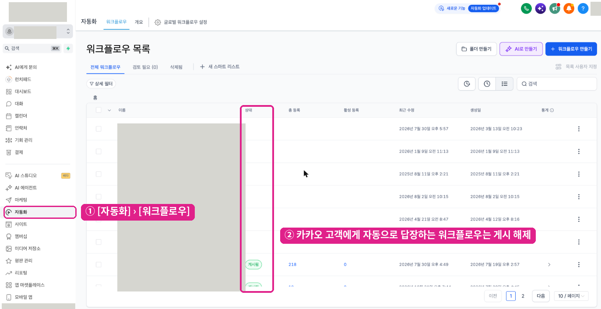
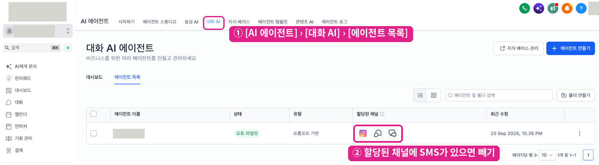

# 5단계 · 답변 방식 고르기

카톡채팅연결 설정 화면 **4단계**(답변 방식)에서 카드를 누르면 바로 저장돼요.

## 두 가지 방식

### 상담원이 답변 (기본 · 추천)

사람이 **대화** 메뉴에서 직접 답해요. 추가 설정도 AI 비용도 없어요.

* 휴대폰 번호가 아직 연결되지 않은 손님에게는 **이름과 휴대폰 번호를 여쭤봐요**(끌 수 없어요, 대화당 최대 2번). 기존 고객 기록과 자동으로 이어 주기 위해서예요. 한 번 연결되면 다시 묻지 않아요.
* 두 번 여쭤도 답이 없으면 대화는 그대로 이어지고, 고객 기록에 `카카오톡_이탈` 태그와 "직접 여쭤 주세요" 메모가 남아요.
* 30분 넘게 쉬었다가 다시 말을 걸면 새 대화로 보고 다시 여쭤봐요.

### AI가 먼저 답변

**AI 에이전트**가 먼저 답하고, 필요하면 상담원이 이어받아요. [선택 D · AI 챗봇 연결](12-ai-chatbot.md)을 함께 해 주세요.

* AI 답변은 손님 화면에 **10~20초** 뒤에 떠요. 정상 범위예요.
* 이름·번호는 AI 프롬프트가 여쭤봐요.
* AI 답장이 손님 메시지의 **첫 답장**(무료)을 쓰기 때문에, 상담원이 이어받아 보내는 답장은 **두 번째부터 답장**이 돼요. 시간과 상관없이 건당 약 15원이고 **채널을 추가한 손님에게만** 가요. 그래서 이 방식은 [6단계 · 늦은 답장 설정](06-late-reply.md)이 꼭 필요해요.

## 다른 자동응답 끄기

손님 메시지마다 약 4분 안의 **첫 답장 1건만 무료**예요. 워크플로우나 AI가 먼저 답하면 그 창을 써 버려서 상담원의 답장은 유료가 되고, 채널을 추가하지 않은 손님에게는 아예 전달되지 않을 수 있어요. 그래서 고른 방식에 맞게 다른 자동응답을 정리해요.

### 1) 자동응답 워크플로우 게시 해제

1. 화면의 [**자동화 열기 ↗**]를 누르거나 왼쪽 메뉴 **자동화 → 워크플로우**로 가세요.
2. 카카오 손님(SMS 채널)에게 **자동으로 답장하는 워크플로우**는 **상태** 열에서 게시를 해제하세요.
3. AI 방식이라면 **AI를 켜는 워크플로우([선택 D](12-ai-chatbot.md))는 그대로 두고** 그 밖의 자동 답장만 해제하세요.

### 2) 대화 AI 채널에서 SMS 빼기 (상담원 방식일 때)

1. 화면의 [**대화 AI 열기 ↗**]를 누르거나 **AI 에이전트 → 대화 AI → 에이전트 목록**으로 가세요.
2. 에이전트의 **할당된 채널**에 **SMS**가 있으면 빼 주세요. 카카오톡은 SMS 유형으로 들어오기 때문에, SMS가 할당돼 있으면 AI가 카카오 손님에게도 답해요.


특정 연락처에서만 봇을 끌 때는 **"24시간 뒤 재활성"** 기본 체크를 해제해 주세요. 그대로 두면 하루 뒤 봇이 다시 켜져 상담원의 무료 답장 창을 먼저 써요.


### 3) 마무리

정리가 끝났으면 화면의 [**껐어요**]를 누르고 [**다음**]을 누르세요. 예약 알림톡을 지금 쓰지 않으면 5단계에서 [**나중에 할게요**]를 눌러 완료 화면으로 가면 돼요. 빠진 일이 있으면 사유와 그 단계로 가는 버튼이 나와요.

다음: [6단계 · 늦은 답장 설정](06-late-reply.md)
