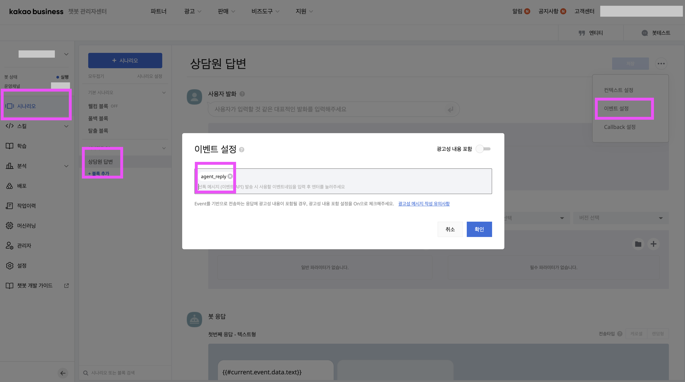

# 6단계 · 늦은 답장 설정 (필수)

손님 메시지 1건마다 **약 4분 안의 첫 답장 1건**은 무료로, 설정 없이도 바로 가요. 하지만 실제 상담에서는 4분을 넘기거나 답장을 여러 번 보내는 일이 많아요. 아래 두 경우를 **늦은 답장**이라고 불러요.

* 손님 메시지 뒤 **약 4분이 지난** 답장
* 같은 손님 메시지에 **두 번째부터** 보낸 답장 (AI가 먼저 답한 뒤 상담원이 이어받는 답장도 여기에 해당해요)

늦은 답장은 건당 약 15원이고, **채널을 추가(친구)한 손님에게만** 전달돼요. 상담원이 시간을 신경 쓰지 않고 답하려면 아래 세 가지를 모두 해 두세요.

카톡채팅연결 **완료 화면**의 **늦은 답장(4분 후)** 카드를 펼치면 ①~③이 순서대로 있어요.


**비즈니스 인증 채널**이어야 늦은 답장을 보낼 수 있어요([1-2](01-kakao-channel.md)). 인증 전에도 나머지 설치는 끝낼 수 있어요. 그동안 늦은 답장은 대화창에 실패 사유로 표시되니, 4분 안에 한 답장으로 모아 답해 주세요.


## ① 비즈월렛 연결

늦은 답장 비용(건당 약 15원)이 빠져나가는 지갑이에요.

1. 오픈빌더 왼쪽 메뉴 **[설정] → [비즈월렛 정보]** 탭을 여세요.
2. 이미 월렛이 있으면 목록에서 [**연결하기**]를 누르세요.
3. 없으면 **[+ 비즈월렛 생성하기]** → 사업자 정보 입력 → 만든 뒤 **캐시 관리**에서 충전하세요. 1만 원이면 600건 이상 보낼 수 있어요.
4. **연결 자산 관리**에 이 봇이 보이면 완료예요.

월렛 하나에 봇 여러 개를 연결할 수 있어요.

## ② agent_reply 이벤트 블록 만들기

상담원이나 AI가 쓴 늦은 답장이 손님 카카오톡에 뜨게 하는 블록이에요.

1. 오픈빌더 왼쪽 메뉴 **[시나리오]** → 시나리오 목록 아래 [**+ 블록 추가**]를 누르세요.
2. 블록 이름은 자유예요(예: `상담원 답변`).
3. 오른쪽 위 [**•••**] → [**이벤트 설정**]을 열고
   * 이벤트 이름 칸에 정확히 `agent_reply`를 입력하고 **엔터**를 누르세요(태그처럼 들어가요).
   * **광고성 내용 포함**은 꺼진 그대로 두세요.
   * [**확인**]을 누르세요.
4. **사용자 발화**는 비워 둬요.
5. **파라미터 설정**에서 스킬을 **고르지 않아요**. 파라미터도 추가하지 않아요.
6. **봇 응답**에서 [**+ 응답 추가**] → [**텍스트**]를 누르고, 카톡채팅연결의 **[말풍선 값 복사]** 값을 **그대로** 넣으세요.

   ```
   {{#current.event.data.text}}
   ```

7. 오른쪽 위 [**저장**]을 누르고, 왼쪽 [**배포**]에서 **배포**까지 하세요.




* 블록 이름보다 **이벤트 이름**이 중요해요. `agent_reply`와 한 글자라도 다르면 늦은 답장이 가지 않아요.
* 이 블록에는 **스킬을 연결하지 마세요.** 연결하면 답장이 대화창에 다시 기록되는 문제가 생길 수 있어요.
* 같은 이벤트 이름을 가진 블록은 **하나만** 있어야 해요.


## ③ 카카오 REST API 키

카카오 디벨로퍼스에서 이 채널과 연결한 앱의 키예요. 비워 두면 늦은 답장이 실패해요.

1. [카카오 디벨로퍼스](https://developers.kakao.com)에 접속해 카카오 계정으로 로그인하세요.
2. **내 애플리케이션 → 애플리케이션 추가하기**에서 앱 이름·회사명을 넣으세요.
3. 만든 앱 → **앱 설정 → 앱 키**에서 **REST API 키**를 복사하세요.
4. **앱 설정 → 카카오톡 채널**에서 1단계의 채널을 **연결**하세요(비즈니스 인증 채널이어야 해요).
5. **제품 설정 → 카카오 로그인**을 **활성화**하세요.
6. 카톡채팅연결 완료 화면 **늦은 답장(4분 후)** 카드의 칸에 REST API 키를 붙여넣고 [**저장**]하세요.


카드에 REST API 키 칸이 보이지 않는 계정은 benjamin@hyperclass.ai 로 알려 주세요.


## 테스트 메시지로 확인하기

같은 카드에서 '**비즈월렛을 연결했어요**'와 발송 동의에 체크하고 [**테스트 메시지 보내기**]를 누르세요. [4단계](04-verify-and-test.md)에서 연결 확인을 한 휴대폰 카카오톡으로 테스트 메시지가 가요(1건, 약 15원).

| 화면 문구 | 해결 |
| --- | --- |
| 비즈월렛 잔액이 부족하거나 연결되지 않았어요 | ① 비즈월렛 연결·충전 확인 |
| 그 카카오톡 계정이 채널을 친구 추가하지 않았어요 | 그 휴대폰에서 채널을 친구 추가한 뒤 다시 |
| 담당자 답장 설정이 아직 준비되지 않았어요 | ③ REST API 키 확인 |
| 테스트 메시지를 보내지 못했어요. 오픈빌더의 agent_reply 이벤트 블록과 배포를 확인해 주세요 | ② 이벤트 이름 확인 → 배포 |
| 카카오톡 연결 확인(확인 코드)을 먼저 완료해 주세요 | [4단계](04-verify-and-test.md) 4-2 먼저 |
| 보냈지만 결과를 아직 확인하지 못했어요 | 카톡에 왔는지 먼저 보세요. 왔다면 다시 보내지 않아도 돼요 |


테스트는 보낼 때마다 요금이 나가요. 결과가 애매하면 **카카오톡에 왔는지 먼저 확인**하세요. 테스트 발송은 하루 3건까지예요.


**오픈빌더에서 하나라도 바꿨다면 마지막에 배포를 다시 한 번 눌러 주세요.**

다음: [7단계 · 실제로 써 보기와 완료 화면](07-first-test.md)
